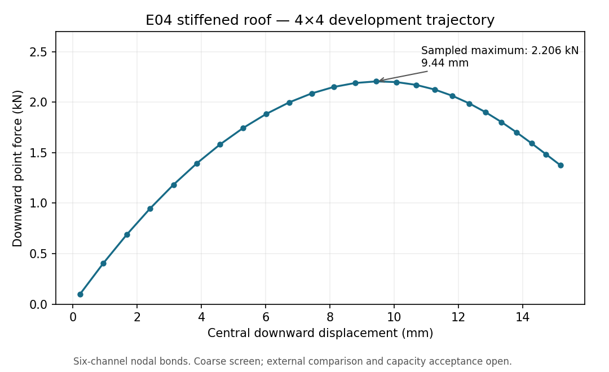

# E04 actual roof development screens

2 October 2026. Base324fede9; product modules unchanged. IMPLEMENTED_NOT_QUALIFIED.

The public definition adapter constructs the actual cylindrical roof, two
centroidal rectangular generalized B3 members and eccentric six-channel nodal
pose bonds. It declares 5/6 shear factors, rectangular Saint-Venant torsion via
the convergent odd-term series, both centroidal bending inertias and explicit
density. No effective flange or second eccentricity is added. Density1kg/m3 is
static API bookkeeping for these runs; spectra and a physical mass claim are
excluded. Generalized yield parameters are an elastic implementation device,
not a strength specification; the elastic-only assembly guard remains active.

Geometry/source adapter checks:5passed,2.43s supervised. Actual screens import
the installed wheel6086fd4edb4246ab77a2c67fb898965e4e71d8020d4c0494b59bbbcb5dbe70b0;
all412current product modules matched that site before each run. Imported solver
location, one numerical thread and disabled JIT are recorded. Each run used
600s/1GiB, serial execution. No performance improvement is claimed.

| Run | Completed behavior | Time / peak tree |
|---|---|---|
| 4x4 | Linear solve,10N seed,two1e-5 arc steps,exact endpoint restore |12.95s /162390016bytes|
| 8x8 | Same route,final12.344N at0.02927mm downward displacement |45.65s /183767040bytes|
| 4x4 bracket |100N seed,24steps of requested radius.003,exact final restore|92.59s /162570240bytes|

The coarse bracket samples a maximum downward force of2206.307N at9.439mm,
followed by11descending samples to1374.343N at15.178mm. All24arc steps accept the
requested radius;96trial evaluations,72linear solves and0rejected candidates
are recorded. Endpoint replay/restore work is additional. The final equilibrium
ratio is2.71e-11 and compatibility8.67e-18 against unchanged1e-8/1e-9criteria.
The completed path establishes a usable coarse ascending/descending trajectory;
the sampled maximum is not a converged or independently validated capacity.

`screens-v1.zip` preserves runners,case/source identities,raw samples,checkpoints,
logs and whitelisted execution metadata. SHA256:
72cce40d1f42afd8dc816a7b79483d4a5108887f7bb10e0d6199d435babd0031.
`summary.json` reports only these run outcomes. The first4x4 runner's `force_n`
field means positive downward force; subsequent runners name downward force
and signed global-z force explicitly after review. No historical output changed.

Independent read review confirmed section axes, centroid properties, offsets,
supports and metric ordering. It found the force-label ambiguity, now corrected.
Reference-route review found no ready exact finite external connector: the E01
affine six-row equations do not implement finite offset rotation; U1/US3 is a
useful physical-DOF mapping starting point but its executed evidence is linear
five-channel coupling. Resolved solid/rigid-port tools have different footprint
and support idealizations. A continuous tied model is not this discrete bond law.

Next: establish the finite external connector/section control or explicitly
matched engineering comparator, then freeze the E04 nonlinear comparison bracket
and refinement contract. A sensible observed region is central downward travel
8–16mm and forces around the sampled2.2kN maximum. Existing programme external,
three-level refinement,5%capacity,imperfection and stability obligations remain.
No aggregate gate closes. Final restore was checked; post-restore continuation
on the actual roof remains an explicit later check.

Bare-roof geometry provenance remains the [Kratos hinged cylindrical roof example](https://kratosmultiphysics.github.io/Kratos/pages/Applications/Structural_Mechanics_Application/Examples/Hinged-cylindrical-roof-snapthrough.html).
Its published response is not an oracle for this stiffened nodal-bond candidate.
